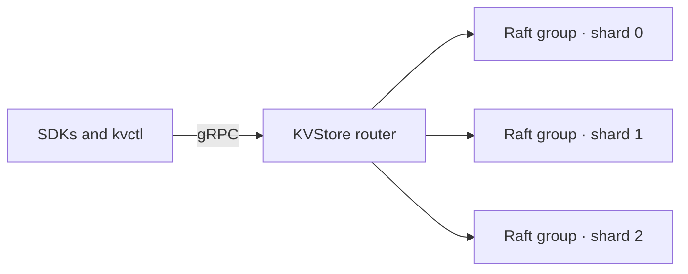

<h1 align="center">KVStore</h1>

<p align="center">
  <strong>A persistent key-value database with a native gRPC API and resumable change streams.</strong>
</p>

<p align="center">
  <a href="https://github.com/byPixelTV/kvstore/releases"></a>
  <a href="#go"></a>
  <a href="#kotlin"></a>
  <a href="#typescript"></a>
</p>

<p align="center">
  <a href="https://github.com/byPixelTV/kvstore/actions/workflows/ci.yml"></a>
  <a href="https://github.com/byPixelTV/kvstore/actions/workflows/release.yml"></a>
</p>

<p align="center">
  <a href="#quickstart">Quickstart</a> ·
  <a href="#sdks">SDKs</a> ·
  <a href="#change-events-and-recovery">Change streams</a> ·
  <a href="#deployment">Deployment</a> ·
  <a href="https://github.com/byPixelTV/kvstore/releases">Releases</a>
</p>

KVStore stores binary values under namespace and key pairs in Pebble. It runs as a single
process for local development or uses Raft replication and a routing layer for sharded
deployments. Applications can read and write through Kotlin, Go or TypeScript and subscribe to
committed changes through the same API.

Download stable binaries from the [Releases page](https://github.com/byPixelTV/kvstore/releases/latest)
or build the server from a checkout with the Compose quickstart.

| Capability | What you can do |
| --- | --- |
| **Read and write** | Choose strong or eventual reads, set optional key expirations, and batch writes within a shard. |
| **Watch and recover** | Subscribe to a key or namespace, resume from a cursor, and rebuild state from a snapshot. |
| **Operate** | Browse records, watch changes and manage API keys in the [`kvctl` terminal console](deploy/kvctl.md). |
| **Secure access** | Use bearer API keys or TLS with client certificates and namespace grants. See [production configuration](deploy/production.md). |

## Quickstart

### Authenticated standalone

Save [`compose.solo.yml`](compose.solo.yml) as `compose.yaml`, put a `KVSTORE_API_KEY`
in `.env` for the first start, then run:

```sh
docker compose up -d --wait
```

Compose pulls the latest stable image and keeps data and credentials in its persistent
volume. See [standalone setup](deploy/production.md#quick-setup-for-one-linux-host)
for the key format and client settings.

### Local development

From a checkout with Docker Compose installed, build and start one standalone node:

```sh
docker compose up -d --build
docker compose ps
```

The local plaintext gRPC endpoint is `127.0.0.1:50051`. The default Compose profile binds it
to loopback and uses a named volume for data. Once the service is healthy, try a write and a
read with [grpcurl](https://github.com/fullstorydev/grpcurl):

```sh
grpcurl -plaintext -import-path api/proto -proto kvstore/v1/kvstore.proto \
  -d '{"namespace":"players","key":"alice","value":"eyJjb2lucyI6MTAwfQ=="}' \
  127.0.0.1:50051 kvstore.v1.KVStore/Set

grpcurl -plaintext -import-path api/proto -proto kvstore/v1/kvstore.proto \
  -d '{"namespace":"players","key":"alice"}' \
  127.0.0.1:50051 kvstore.v1.KVStore/Get
```

The read returns `found: true` and the bytes for `{"coins":100}`. Protobuf JSON represents byte
fields as base64. Stop the local server with `docker compose down` when you are done.

For a hands-on terminal console, try the [Windows demo](deploy/kvctl.md#try-the-windows-demo).

## SDKs

Connect to the server endpoint in standalone or single-Raft mode, or to the router in a
sharded deployment. See [release channels](#release-channels) for package versions and feeds.

| Runtime | SDK | Stable package |
| --- | --- | --- |
| Kotlin/JVM 17+ | [sdk/kotlin](sdk/kotlin) | `dev.bypixel:kvstore` on [ByPixel Maven](https://repo.bypixel.dev/releases/) |
| Go 1.27.4+ | [sdk/go](sdk/go) | `github.com/byPixelTV/kvstore/sdk/go` |
| Node.js 22+ | [sdk/typescript](sdk/typescript) | `@bypixeltv/kvstore` on npm |

Clients use TLS by default. Pass an API key when the server requires bearer authentication.
All three accept custom trust roots and client certificates. Use explicit plaintext settings for a local plaintext endpoint.
All three support atomic callback transactions across shards, renewable key leases, and local
namespace caches that follow committed changes.

KVStore stores bytes. The typed helpers store UTF-8 JSON, so the same value can be read from
Kotlin, Go and TypeScript. EraMC's `storeName` maps to `namespace` and its key stays the same.
Use the raw operations for binary data or a custom codec.

### Kotlin

```kotlin
repositories {
    mavenCentral()
    maven("https://repo.bypixel.dev/releases/")
}
dependencies {
    implementation("dev.bypixel:kvstore:1.2.2")
}
```

Apply the Kotlin serialization compiler plugin for `@Serializable` data classes.

```kotlin
import dev.bypixel.kvstore.KVStoreClient
import kotlinx.coroutines.launch
import kotlinx.serialization.Serializable

@Serializable
data class Player(val coins: Int)

// Inside a coroutine scope owned by your application or plugin:
val kvstore = KVStoreClient.connect("kv.example.com:50051", apiKey = System.getenv("KVSTORE_API_KEY"))
kvstore.set("players", "alice", Player(100))
val alice = kvstore.getCached<Player>("players", "alice")
val listener = launch {
    kvstore.onChange("players").collect { change ->
        if (change.deleted) println("Deleted ${change.key}")
        else println(kvstore.json.decodeFromString<Player>(change.value.toStringUtf8()))
    }
}
// At shutdown:
listener.cancel()
kvstore.close()
```

`getCached<T>` uses a bounded, expiring local cache and reads strongly on a miss.
The defaults are 4,096 entries and five seconds. Local writes evict affected keys.
Collect `watch` or `onChange` for the keys you want invalidated by remote writes as changes arrive.
Values with a server expiration also expire locally. Use `get<T>` for a fresh strong read.
Pass a custom `Json` instance to reuse application serializers.
Use `readJson<T>` and `cachedJson<T>` when reading typed values through the watched
namespace cache. `cachedJson<T>` is synchronous and only reads local cache entries.

Use `transaction` for a callback whose staged writes commit atomically across namespaces
and shards. The SDK executes the callback once and checks the recorded revisions and leases
at commit. Use `withKeyLock` for a renewable distributed lease. Lease-backed writes such as
`writeText` check ownership when they commit.

```kotlin
kvstore.transaction { tx ->
    tx.set("players", "alice", "active")
    tx.set("audit", "alice-login", "recorded")
}
kvstore.loadNamespace("players")
val cachedStatus = kvstore.cachedText("players", "alice")
```

`loadNamespace` starts a resumable watch from the scan checkpoint. Use `cachedText` for a
synchronous local lookup and `subscribeToNamespace` for change notifications. Use `cachedBytes`
and the transaction's `getBytes` and `setBytes` for binary values. A null key in
a notification means the client rescanned the namespace. Close the subscription when it is no
longer needed and close the client to stop its watches.

### Go

See the [Go SDK guide](sdk/go/README.md) for namespace cache examples.

```sh
go get github.com/byPixelTV/kvstore/sdk/go@v1.2.2
```

```go
import kvstore "github.com/byPixelTV/kvstore/sdk/go"

type Player struct {
    Coins int `json:"coins"`
}

client, err := kvstore.Dial("kv.example.com:50051", kvstore.Options{APIKey: os.Getenv("KVSTORE_API_KEY")})
if err != nil { return err }
defer client.Close()

if _, err := kvstore.SetJSON(ctx, client, "players", "alice", Player{Coins: 100}, 0); err != nil {
    return err
}
player, found, err := kvstore.GetJSON[Player](ctx, client, "players", "alice")
// Watch returns a stream. Call Recv() until a stream error or ctx cancellation.
// Pass a cursor to resume, or nil to start at the current head.
stream, err := client.Watch(ctx, "players", "", nil)
```

### TypeScript

```sh
npm install @bypixeltv/kvstore@snapshot
```

```ts
import { KVStoreClient, cursorFromChange } from "@bypixeltv/kvstore";

type Player = { coins: number };
const client = new KVStoreClient("kv.example.com:50051", { apiKey: process.env.KVSTORE_API_KEY });
await client.setJson("players", "alice", { coins: 100 });
const alice = await client.getJson<Player>("players", "alice");
const controller = new AbortController();

try {
  for await (const change of client.watch("players", { signal: controller.signal })) {
    if (!change.checkpoint) console.log(change.key, change.deleted);
    const cursor = cursorFromChange(change);
    // Persist cursor after processing the frame if you need to resume.
  }
} finally {
  client.close();
}
```

Call `controller.abort()` from your application's shutdown or unsubscribe handler.
Revisions and expiration timestamps in TypeScript responses are decimal strings to preserve 64-bit precision.

## Change events and recovery

- Watch a namespace or a single key. Changes describe committed sets and deletes. Checkpoints
  advance the resume position during idle periods and when other keys change. Watches with no
  starting cursor fetch the current head and require permission to call `Head`.
- Persist the last processed cursor, including checkpoints, and pass it back on reconnect.
  Process replays idempotently. In a sharded deployment, the cursor is opaque and ordering is per shard.
- On `OUT_OF_RANGE` or `FAILED_PRECONDITION`, replace your local state with a completed namespace
  scan and restart the watch from the scan checkpoint. Standalone and single-Raft scans emit that
  checkpoint first. Router scans emit it last. Save the checkpoint only after the scan succeeds.
- Respect `expiresAtUnixMs` in application state. Expiration is enforced by the server on reads
  and scans. Handle TTL locally if displaying state from a change stream.
- `BatchWrite` groups ordered writes atomically within a shard. Check every result for a
  multi-shard batch. A transport failure can leave the write outcome unknown.

### Conditional transactions

`Transact` checks observed revisions or exact bytes and commits all requested writes atomically,
including across routed Raft groups. Revision zero matches absent or expired records. Use
strong reads for observed revisions. A response with `committed=false` means the checks or
transaction deadline prevented the commit. After an ambiguous transport error, repeat the exact
request with the same ID to resolve its durable outcome.

Each request supports up to 4,096 checks and 4,096 ordered writes, subject to the 2 MiB request and
3 MiB coordinator encoding limits. Deploy transaction-capable voters before starting the new
router. As with live resharding, only one router may serve writes while routing ownership changes.

The Go client includes an owner-checked `WithKeyLock` helper that renews a lease while the
callback runs. Use its context for writes made through the transaction helper so the lease
owner is checked at commit. API keys or client certificates using the helper need read and write
grants on the `kvstore-leases` namespace in addition to the relevant data namespaces.

## Deployment

In sharded mode, the gRPC router maps each key to a Raft group. The groups replicate their writes
independently. The checked-in Compose topology runs three voters per group.

Use the native Windows server for standalone mode. Run Raft voters on Linux or in Linux
containers, including Docker Desktop on Windows.



| Mode | Entry point | Guide |
| --- | --- | --- |
| **Standalone** | [`compose.solo.yml`](compose.solo.yml) | [Authenticated quickstart](#authenticated-standalone) |
| **Single Raft group** | [`compose.cluster.yml`](compose.cluster.yml) | [Linux deployment](deploy/production.md) |
| **Sharded** | [`compose.sharded.yml`](compose.sharded.yml) | [Production profiles and TLS](deploy/production.md#production-with-compose) |
| **Kubernetes** | [`deploy/kubernetes/`](deploy/kubernetes/) | [Kubernetes setup](deploy/kubernetes/README.md) |

The [gRPC specification](api/proto/kvstore/v1/kvstore.proto) documents the data API and
cursor formats.

## Release channels

After CI tests the SDKs against an authenticated KVStore and installs the built npm tarball,
the release workflow publishes the packages and existing server artifacts from the tested commit.

| Channel | Go module tag | Maven | npm |
| --- | --- | --- | --- |
| `stable` | `v<VERSION>` | Releases repository, `<VERSION>` | `latest`, `<VERSION>` |
| `nightly` | `v<VERSION>-SNAPSHOT.<run>.<attempt>` | Snapshots repository, `<VERSION>-SNAPSHOT` | `snapshot`, `<VERSION>-SNAPSHOT.<run>` |

Use the SDK commands above for the stable release. The [Compose quickstart](#quickstart)
builds the server locally and works without GHCR access.

GitHub configures container package visibility separately from repository visibility.
Before advertising a GHCR pull command for a public release, make the package public
and verify the intended tag pulls anonymously.

Set `BYPIXEL_REPO_USER` and `BYPIXEL_REPO_TOKEN` in GitHub Actions for Maven publishing.
Use the Reposilite token name as the user and its secret as the token. Give the token read and
write access to these two routes:

- `/releases/dev/bypixel/kvstore/`
- `/snapshots/dev/bypixel/kvstore/`

Reposilite matches literal path prefixes. Keep the trailing slash to scope the routes to this
artifact. Adding `*` to the route causes it to miss uploads. [Reposilite route rules](https://reposilite.com/guide/routes)

npm publishing uses GitHub Actions OIDC. Go uses the GitHub release tag.
Set the release version in [VERSION](VERSION). The nightly Maven repository is
[ByPixel Snapshots](https://repo.bypixel.dev/snapshots/). Install the nightly npm package with
`npm install @bypixeltv/kvstore@snapshot`.

### First npm publication

npm configures trusted publishers per package. If `@bypixeltv/kvstore` has no package page yet,
publish the current SDK once as an interactive bootstrap using an npm account with write access
to `@bypixeltv`. Run these commands from the repository root before triggering a release:

```sh
cd sdk/typescript
npm ci
npm login --registry=https://registry.npmjs.org
npm publish --registry=https://registry.npmjs.org --access public --tag bootstrap
```

Approve the npm 2FA prompt. The package manifest uses version `0.0.0` for this local publish.
The initial npm publication may also appear under `latest`. The stable workflow updates `latest`
when it publishes the first stable release.

In the npm package settings under **Trusted Publisher**, choose **GitHub Actions** and enter
organization or user `byPixelTV`, repository `kvstore`, and workflow filename `release.yml`.
Leave the environment field empty and enable **Allow npm publish**. Trigger a successful
GitHub release within two days of saving the configuration.
See the [npm Trusted Publishing docs](https://docs.npmjs.com/trusted-publishers/).

## Development

Run the server tests with the race detector on Linux, then test and package the SDKs against an
isolated KVStore instance. The second command also needs JDK 21 and Node.js 24.

```sh
go test -race ./...
bash scripts/test-sdks.sh 1.2.2 "$PWD/tmp/sdk-packages"
```

## License

KVStore is available under the [MIT License](LICENSE).
